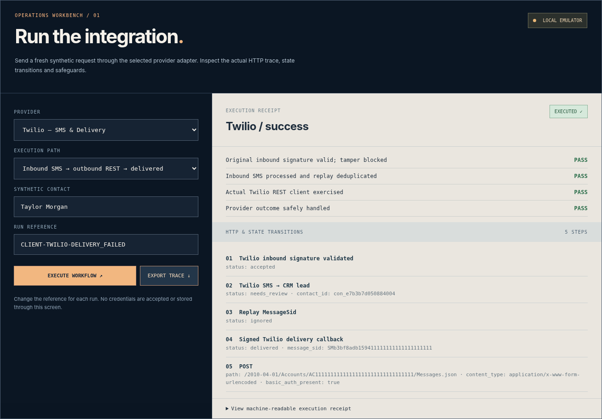

# NECTELIS | ClientFlow AI
## Signal Room · Integration Operations Edition

A runnable **FastAPI + SQLite** lead-processing system and provider integration workbench. The release demonstrates cross-system engineering through executable connector code, stateful operations, signed webhooks, durable records, and reproducible failure tests. Its default environment is an **isolated, synthetic local sandbox**; no external provider is contacted without separate operator authorization.



### Get started

**Windows:** extract into a new folder → run `RUN_WINDOWS.bat` → open [http://127.0.0.1:8000](http://127.0.0.1:8000) → navigate to **02 Integrations** → select a provider and run. Full walkthrough: [`OPERATIONS_START_HERE.md`](OPERATIONS_START_HERE.md).

**Validation:** double-click `RUN_TESTS_WINDOWS.bat`; it runs pytest and a fresh 12-case provider scenario suite in a temporary SQLite database. Independent JSON reports can be exported from the browser or CLI.

### Implemented

| Area | Executable functionality | Verification boundary |
|---|---|---|
| Local lead-to-booking engine | Typed webhooks, contact lookup/upsert, qualification, booking conflict detection, replay ledger, local follow-ups/audit | SQLite and API tested |
| GoHighLevel | Actual HTTP connector methods for contacts, opportunities, availability, appointments; orchestrated success/retry/401/timeout paths | Emulator contract tested; **live GHL not connected** |
| Vapi | Authenticated end-of-call intake, structured-data normalization, replay by call ID, local CRM lookup and booking | Local API and SQLite tested; no real voice call |
| Twilio | Form webhook signatures, SMS-to-review, outbound REST client with Basic Auth, allowlist/consent guard, delivery callbacks and persisted status transitions | Real client code tested against emulator; no SMS sent |
| Authorized vendor tests | Explicit opt-in CLI, per-account configuration and durable job reservations against ambiguous writes | Code/unit tested; requires live provider verification |
| Integrations UI | Editable provider, scenario, name and reference; backend-generated traces; download execution receipt | 12/12 browser-driven local scenarios tested |
| Configurable business profiles | Home services and real estate YAML configurations | Locally tested |
| n8n | Portable workflow JSON export | Not imported into live workspace |

### Repository orientation

```text
clientflow/                FastAPI, schema validation, local state, provider connectors
  api.py                  Intake, provider callbacks, integration run API
  service.py              Local lead/booking engine
  provider_orchestrator.py   GHL contact → opportunity → slot → appointment
  ghl_connector.py        Actual GHL HTTP methods
  channel_adapters.py     Twilio + Vapi event normalization and signature checks
  twilio_gateway.py       Twilio REST sender + signed status callbacks
  live_bridge.py          Guarded GHL live-test jobs and durable replay state
  workbench.py            Reviewer-editable provider executions
frontend/                 Signal Room UI, CSS, JS
tests/                    Regression, security, integrations
scripts/                  Independent execution evidence, activation CLI
config/                   Industry profile YAML
evidence/                 Screenshots and sanitized offline verification
n8n/                      Workflow JSON (workspace import pending)
docs/                     Activation and technical notes
portfolio/                Case study and scenario-specific proposal material
```

### Real account activation

Do **not** paste tokens in the web interface. Copy `.env.example` to an ignored `.env` and follow [`docs/PROVIDER_ACTIVATION.md`](docs/PROVIDER_ACTIVATION.md). The optional activation CLI does nothing remotely unless explicitly authorized. Provider subscriptions/credentials **alone are not sufficient**: GHL location, pipeline, stages, calendar and availability; Vapi assistant/server URL and authentication; Twilio phone number, messaging permissions, HTTPS callback URLs and recipient consent must also be configured. External responses, telephony delivery and permissions have **not** been live-tested for this release.

**Live-test path:** Authorized Vapi end-of-call events can optionally call the guarded GHL test-account bridge. This switch is disabled by default and must be verified with real account access. Twilio voice/SIP forwarding, Vapi synchronous in-call tool-calls, native GHL snapshots and a full production multi-tenant SaaS are **not** included.

### Safety and scope

- Local synthetic data only by default; real messaging/outbound disabled.
- Browser UI does not accept provider secrets.
- Replay and ambiguous write outcomes are isolated rather than silently retried.
- Restricted recipient allowlists, opt-in and explicit write switches govern authorized test sends.
- Signatures are validated on classic Twilio form webhooks, and Vapi secret on authenticated end-of-call reports.
- Dashboard does **not** have user authentication and is intended only for private localhost operation, not an exposed public server.
- Production requires additional security, permission, rate-limiting, backup and compliance work, plus provider-specific live tests.

### Client walkthrough and proof assets

[`docs/CLIENT_DEMO_STORYBOARD.md`](docs/CLIENT_DEMO_STORYBOARD.md) · [`docs/ENGINEERING_CHANGELOG.md`](docs/ENGINEERING_CHANGELOG.md) · [`portfolio/CASE_STUDY_OPERATIONS.md`](portfolio/CASE_STUDY_OPERATIONS.md)

The correct client-facing description is **“implemented and offline-tested integration adapters with a working local CRM/booking engine; live account-specific validation is performed on authorized provider accounts.”** Do not state that a real GHL location was connected, that phone calls/SMS occurred, or that the interface alone proves production readiness.
