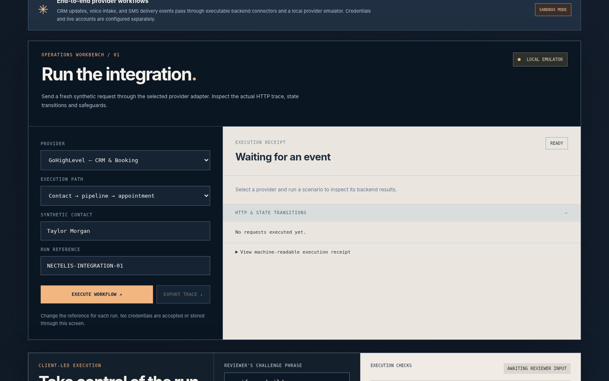
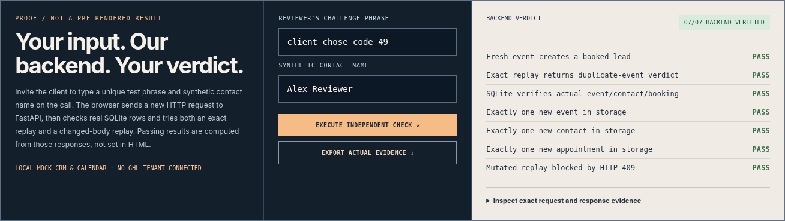
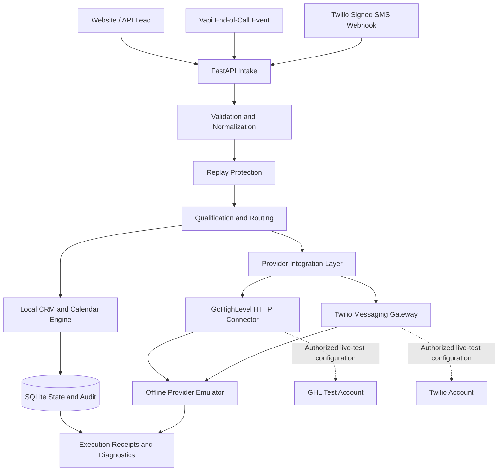

# NECTELIS — ClientFlow AI

### Voice-event processing. CRM orchestration. Appointment automation. Built for reliability.

**Python · FastAPI · Vapi · Twilio · GoHighLevel · SQLite · REST APIs · Webhooks**

ClientFlow AI is a configurable lead-to-booking automation system developed by **NECTELIS**, a software engineering team specializing in AI automation, backend services, and API integrations.

The system demonstrates how customer inquiries and structured voice-agent events can be validated, qualified, synchronized with CRM records, routed through scheduling workflows, and monitored through detailed execution traces.

It goes beyond the basic webhook-to-CRM pattern by implementing replay protection, appointment conflict handling, provider error classification, webhook authentication, retry safeguards, and persistent audit records.

**Implementation status:** Working local application with executable, offline-tested provider integrations. Real GHL, Vapi, and Twilio account activation requires authorized credentials, provider setup, and live integration testing.

---

## Application Preview



*Integration Operations Workbench — configurable scenarios, provider operations, execution receipts, and API traces.*

### Independent Execution Verification



*Reviewer-controlled inputs are processed through FastAPI and checked against persistent SQLite records, including duplicate-event and conflicting-replay scenarios.*

---

## The Business Problem

Customer inquiries often pass through multiple disconnected systems: a website form, voice agent, CRM, calendar, notification service, and internal operations team.

A simple automation may work when everything succeeds, yet behave unpredictably when:

- The same webhook arrives more than once.
- A contact already exists in the CRM.
- An appointment slot is no longer available.
- A provider returns HTTP 429 or 401.
- A remote operation succeeds but its response is lost.
- A delivery callback reports an unsuccessful message.
- An incoming payload is malformed or unauthorized.

ClientFlow AI addresses these problems through a structured processing engine and isolated provider connectors, making each operation observable and testable.

## System Architecture



The default application runs locally with synthetic data. The provider workbench exercises integration methods against controlled API responses. Optional live-test paths are separately configured and guarded.

## Core Capabilities

| Engineering area | Implemented functionality |
|---|---|
| Lead ingestion | Typed REST endpoints, webhook intake, validation and normalization |
| CRM operations | Contact identification, lookup, create/update behavior and configurable routing |
| Qualification | Deterministic business-rule evaluation |
| Scheduling | Availability checks, appointment creation and conflict handling |
| State management | Persistent local contacts, events, appointments and audit records |
| Replay protection | Event identity tracking and duplicate-action prevention |
| API reliability | Bounded retries, failure classification and ambiguous-write handling |
| Security | Webhook signature verification, restricted outbound operation and test-recipient controls |
| Diagnostics | Structured execution receipts, HTTP traces and audit inspection |
| Configuration | Home-services and real-estate business profiles |
| Testing | Automated regression tests and executable provider scenarios |

## Provider Integration Engineering

### 01 — Vapi | Voice-Event Processing

ClientFlow AI includes a Vapi event adapter that accepts authenticated, structured end-of-call reports and converts them into normalized lead events.

**Implemented behaviors:**

- Authenticated end-of-call event ingestion.
- Structured customer information extraction.
- Stable event identification using call information.
- Lead qualification and local CRM processing.
- Appointment scheduling through the local processing engine.
- Duplicate-event protection.
- Malformed-event rejection and execution logging.

**Demonstrated workflow:**

`Vapi event → FastAPI → Validation → Lead processing → CRM record → Appointment → Audit`

**Verification boundary:** End-of-call processing is tested locally. A live Vapi conversation, real-time audio pipeline, and synchronous in-call tool execution are not demonstrated by this repository.

### 02 — Twilio | Messaging Integration

The Twilio integration implements webhook security, outbound messaging request construction, and delivery-status processing.

**Implemented behaviors:**

- Inbound SMS webhook normalization.
- Twilio signature verification.
- Rejection of modified or invalid signatures.
- Outbound REST API client using authenticated requests.
- Consent and permitted-recipient safeguards.
- Signed delivery-status callback processing.
- Persistent message status transitions.
- Simulated rate-limit and delivery-failure handling.

**Demonstrated workflow:**

`Inbound SMS → Signature validation → Lead processing → Outbound request → Delivery callback → Persistent audit`

**Verification boundary:** Provider requests and callbacks have been tested offline. The release does not demonstrate a real SMS delivery, live telephone call, or Twilio voice/SIP operation.

### 03 — GoHighLevel | CRM and Calendar Integration

The GoHighLevel connector contains executable HTTP methods and an orchestration layer for common CRM and appointment operations.

**Implemented behaviors:**

- Contact upsert requests.
- Opportunity upsert and stage management.
- Calendar availability requests.
- Appointment creation requests.
- HTTP 429 retry behavior.
- Authorization-failure handling.
- Replay protection.
- Reconciliation handling for uncertain booking outcomes.

**Demonstrated workflow:**

`Lead → Contact upsert → Opportunity → Calendar availability → Appointment → Stage update`

**Verification boundary:** These operations have been exercised against an offline provider emulator. An actual HighLevel location, pipeline, and calendar have not been connected or live-verified.

### 04 — n8n | Workflow Orchestration

The repository includes an n8n workflow export for orchestration and integration demonstrations.

The workflow is supplied as a reusable integration artifact. Import and execution in an authorized n8n workspace require separate validation.

## Engineering Reliability

ClientFlow AI places particular emphasis on situations where integrations frequently fail.

| Scenario | Expected system behavior |
|---|---|
| Repeated lead event | Recognize replay and avoid duplicate downstream actions |
| Same event ID, changed request | Reject conflicting replay with HTTP 409 |
| Existing contact | Update the appropriate record rather than blindly creating another |
| Unavailable appointment | Refuse the booking safely |
| Provider rate limit | Apply bounded recovery behavior |
| Provider authorization failure | Stop unauthorized operations and record the failure |
| Uncertain booking response | Require reconciliation instead of blindly repeating a potentially successful write |
| Failed message delivery | Record delivery state and expose the failure |
| Invalid or tampered webhook | Reject the request before trusted processing |

The goal is not to claim that failures never happen, but to make failure handling explicit, recoverable where possible, and inspectable.

## Verification and Test Evidence

The packaged October 2026 release recorded:

| Verification | Release result |
|---|---|
| Python automated tests | 82 passing |
| Provider operations matrix | 12/12 passing |
| Browser-driven offline scenarios | 12/12 passing |
| Live external provider calls during release testing | 0 |

These are **release-specific offline results**, not production metrics. Results can be reproduced locally.

### Run the tests

On Windows:

```powershell
.\RUN_TESTS_WINDOWS.bat
```

Or run the Python suite directly:

```powershell
.\.venv\Scripts\python.exe -m pytest -q
```

The test launcher also executes the provider operations matrix and produces local JSON evidence.

For a deeper review, inspect the relevant tests in `tests/` and the scenario execution utilities in `scripts/`.

---

## Quick Start

### Requirements

- Windows, macOS, or Linux.
- Python 3.11 or newer, with Python 3.11 recommended for the included Windows launcher.
- Internet access for installing Python dependencies.
- No paid GHL, Vapi, or Twilio account required for local testing.

### Windows

Clone the repository:

```bash
git clone https://github.com/MukhtarHassan1/NECTELIS-ClientFlow-AI.git
cd NECTELIS-ClientFlow-AI
```

Start the application:

```powershell
.\RUN_WINDOWS.bat
```

Then open:

**http://127.0.0.1:8000**

### Manual Python Setup

```bash
python -m venv .venv
```

Activate the virtual environment and install dependencies:

```bash
pip install -r requirements.txt
```

Start FastAPI:

```bash
uvicorn clientflow.api:app --host 127.0.0.1 --port 8000
```

For platform-specific instructions, consult [Operations Setup](docs/OPERATIONS_START_HERE.md).

### Explore the Application

**Test Studio:** Execute lead-management, scheduling, replay, and failure scenarios.

**Integrations:** Run configurable Vapi, Twilio, and GHL provider scenarios and inspect execution receipts.

**Evidence:** Review stored execution results and audit activity.

**System:** Inspect supported configuration and runtime information.

Keep the application on localhost unless it has been independently secured for public deployment.

---

## Integration Activation

The repository separates demonstration configuration from authorized provider credentials.

Copy `.env.example` into an ignored `.env` file and configure only the provider services you intend to test.

Never commit credentials or paste private API keys into a public issue or browser screenshot.

See [Provider Activation Guide](docs/PROVIDER_ACTIVATION.md) for provider-specific steps.

**GoHighLevel:** Requires an authorized location, appropriate permissions, pipeline/stage mapping, calendar configuration, and live API validation.

**Vapi:** Requires an authorized account, assistant setup, webhook/server URL, authentication, structured event configuration, and actual call testing.

**Twilio:** Requires an authorized account, a permitted sender, messaging configuration, publicly reachable HTTPS callbacks, and consent-compliant test recipients.

Credentials alone do not establish deployment readiness. Each integration requires account-specific configuration and end-to-end validation.

---

## Repository Structure

```text
NECTELIS-ClientFlow-AI/
│
├── clientflow/              # FastAPI engine and provider connectors
├── frontend/                # Signal Room interface
├── config/                  # Configurable industry profiles
├── fixtures/                # Synthetic test payloads
├── tests/                   # Regression and integration-contract tests
├── scripts/                 # Independent verification and setup utilities
├── n8n/                     # Workflow export
├── evidence/                # Offline execution and visual evidence
├── assets/readme/           # GitHub presentation screenshots
├── docs/                    # Architecture, activation and handoff material
├── portfolio/               # Technical case study and demonstration materials
├── .github/workflows/       # CI configuration
│
├── .env.example             # Safe environment variable template
├── requirements.txt         # Python dependencies
├── pyproject.toml           # Python project configuration
├── Dockerfile               # Container build definition
├── compose.yaml             # Container composition configuration
├── RUN_WINDOWS.bat          # Windows application launcher
└── RUN_TESTS_WINDOWS.bat    # Windows verification launcher
```

## Technical Documentation

- [Provider Activation](docs/PROVIDER_ACTIVATION.md)
- [Client Demonstration Storyboard](docs/CLIENT_DEMO_STORYBOARD.md)
- [Engineering Change Log](docs/ENGINEERING_CHANGELOG.md)
- [Operations Setup](docs/OPERATIONS_START_HERE.md)
- [Technical Case Study](portfolio/CASE_STUDY_OPERATIONS.md)

## Engineering Decisions

**Deterministic operations for critical actions.** Contact identity, replay handling, permission checks, and booking availability should not depend on unvalidated LLM decisions.

**Provider isolation.** External API methods are separated from core lead-processing logic to support replacement, testing, and account-specific configuration.

**Explicit failure states.** Authentication failures, timeouts, booking conflicts, and delivery errors remain visible rather than being silently reported as successful operations.

**Reproducibility.** Synthetic fixtures, local persistence, test scripts, and documented runtime options allow engineers to examine behavior without access to private customer accounts.

**Measured claims.** Offline tests and provider contract validation are distinguished from live integration verification and production deployment.

## Scope and Limitations

This repository is an engineering demonstration and integration foundation—not a production-certified SaaS platform.

The release does not establish:

- A live GHL deployment or native GHL snapshot.
- A deployed Vapi or Twilio voice agent handling real calls.
- Measured conversational latency, STT/TTS performance, or interruption handling.
- Live SMS delivery.
- An independently verified n8n Cloud execution.
- Multi-tenant production security or regulatory compliance.

The local dashboard is intended for private development and demonstration. Production use would require authentication, operational monitoring, infrastructure hardening, backups, access controls, and provider-specific end-to-end tests.

## About NECTELIS

**NECTELIS — AI Automation, Integrations & Software Development**

We build practical automation systems, connect business software, develop API-driven applications, and implement workflows that prioritize maintainability and reliable operation.

Our work spans AI automation, voice-agent integrations, CRM systems, Python and Node.js backend development, web applications, and business process engineering.

ClientFlow AI is part of our portfolio of reusable technical demonstrations.

**Explore the implementation. Review the tests. Examine the failure paths.**

---

### Copyright and Usage

© 2026 NECTELIS.

No general open-source license has been selected for this repository. Public availability does not automatically grant permission for redistribution or commercial reuse.

See [Copyright and Licensing Notes](docs/LICENSE_DECISION.md).
