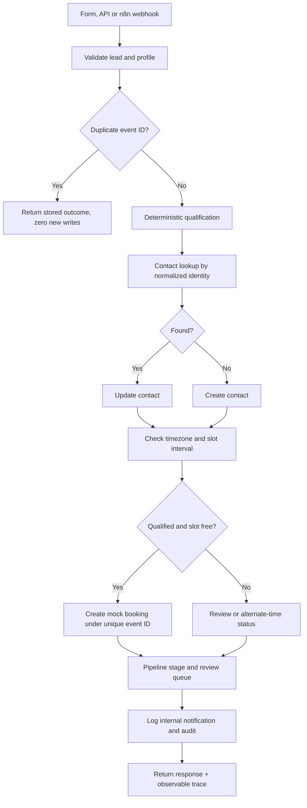

# Architecture | ClientFlow AI

## Truth in labels

Core runtime: **FastAPI + SQLAlchemy + SQLite (default) / PostgreSQL (Compose)**. A **mock CRM and calendar** are implemented in database models, not in a real GHL sub-account. The optional **local Ollama** JSON advisory is real inference only when configured. It has no authority over contact identity, consent, slot availability, or booking. The **GHL adapter and isolated validation CLI** are supplied but **not connected to the core engine and not live-tested**.

## Run path



## Design choices

- **Unique event identity:** `UNIQUE(client_key, source, external_event_id)`; repeated event produces a stored result and no additional CRM, booking, follow-up or notification.
- **Contact identity:** normalized email or E.164 phone; uniqueness per profile; conflicting email+phone matches are quarantined for human review, not merged automatically. This is a *demo heuristic*, not universal contact identity for production CRMs.
- **Booking conflict:** checks interval overlap and persists with `UNIQUE(client_key, start_at)` and event unique mapping; a per-process lock serializes the check in a one-worker demo. This does **not** guarantee distributed race protection under multiple workers or third-party calendars.
- **Transaction:** in mock mode the event, booking, follow-up and audit are committed together. External APIs do not share the local database transaction; real connectors need idempotency/reconciliation, durable queues and distributed coordination.
- **Retry:** mock connector accepts a deterministic HTTP-status sequence such as `429,200` and uses capped attempts, with simulated exponential delays. These are **not measured live API retries**, and no live `Retry-After` header is available in this mode.
- **Errors:** persistent 401 and other 4xx stop; notification failure records a distinct failure without undoing booking; calendar failures preserve the lead in review. A simulated `timeout_after_create` is reconciled using the durable event ID before any duplicate write.
- **Dry-run:** no database writes, provider writes, or notifications. Returns a planned action summary.
- **Notification evidence:** local audit log by default; optional `TEST_MAILPIT_ENABLED=true` captures synthetic team emails in a local-only Mailpit inbox. There is no external outreach channel.
- **Security:** no external outreach channel; browser interface is for localhost demonstrations, not internet-facing deployment.

## API surface

| Method | Route | Role |
|---|---|---|
| GET | `/` | Interactive scenario lab |
| GET | `/api/v1/health` | Honest runtime status |
| GET | `/api/v1/profiles` | Two configured industries |
| POST | `/api/v1/leads` | Validated lead processing |
| GET | `/api/v1/state` | Masked synthetic dashboard state |
| GET | `/api/v1/audit/{event_id}` | Per-event audit trace |
| POST | `/api/v1/admin/reset` | Delete synthetic demo rows |

Set `WEBHOOK_API_KEY` and `ADMIN_API_KEY` to require the respective headers on API routes; do not expose the demo UI and reset route publicly. This is a demo, not a hardened production service.

## Repository

```text
clientflow/  API, schemas, adapters, DB models and orchestration
config/      Two industry YAML profiles
frontend/    Lightweight responsive proof lab (no build step)
fixtures/    Synthetic input events
n8n/         Exportable intake workflow and build helper
tests/       Backend and GHL API contract tests
evidence/    Actual local test output and screenshots
docs/        Setup, limitations, recording, GHL instructions
scripts/     Local walkthrough and deliberately isolated GHL smoke harness
```

### Fully-scoped audit route and replay integrity (Signal Room upgrade)

`GET /api/v1/audit/{client_key}/{source}/{event_id}` is preferred. Older unscoped routes return HTTP 409 when their lookup is ambiguous, rather than silently showing another profile/source event. The event ledger now stores a SHA-256 request fingerprint. Exact replays are idempotent, while changed content reusing the same identity is HTTP 409. New SQLite demo databases contain this field; older local SQLite databases receive a conservative additive column migration.
